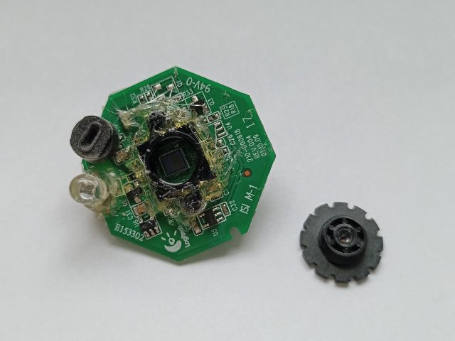
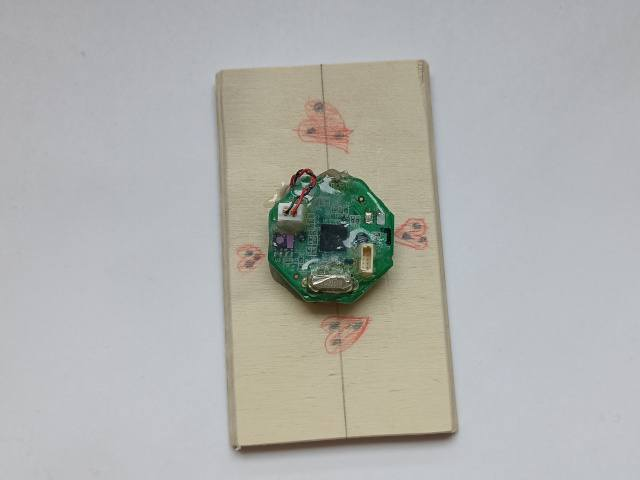
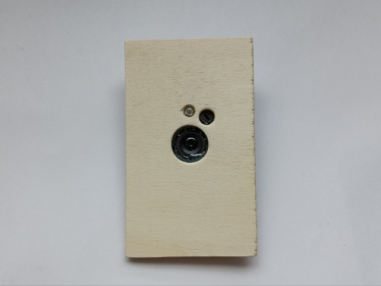
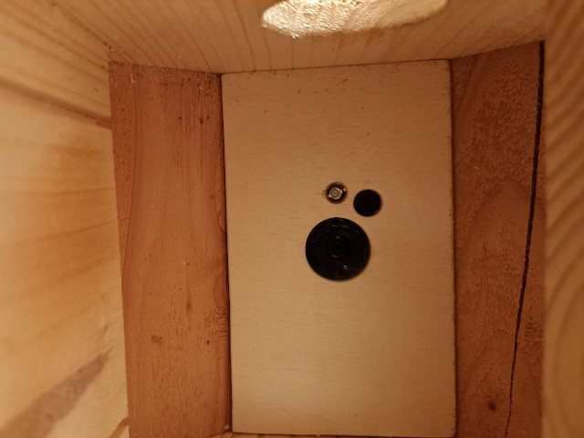
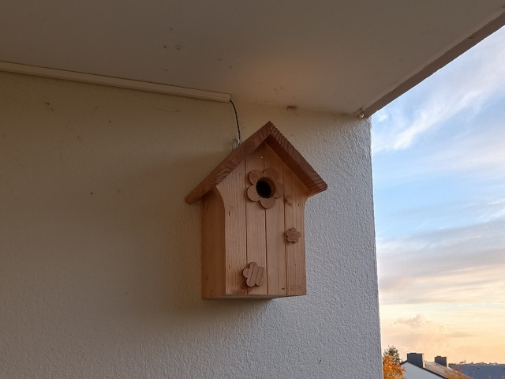
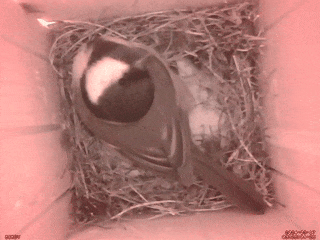

# BirdyCamCam

A Raspberry Pi webcam streaming setup that broadcasts a live video and audio
stream over RTSP and HLS using FFmpeg and
[MediaMTX](https://github.com/bluenviron/mediamtx).

## Hardware

| Component | Details |
|-----------|---------|
| Board | Raspberry Pi 4 (2GB) |
| Camera | Logitech C200 (any UVC-compatible webcam works) |

### Assembly

The Logitech C200 was modified for the birdhouse installation:

- PCB removed from its housing and mounted on a board inside the birdhouse
- Infrared filter removed from the lens to enable night vision (at the expense of colour accuracy)
- Green LED replaced with an infrared LED to illuminate the nest

| | |
|---|---|
|  |  |
|  |  |
|  |  |

## Architecture

```
Webcam  (V4L2) ──┐
                  ├─▶ FFmpeg (H.264 hw + AAC) ──RTSP──▶ MediaMTX ─┬─▶ RTSP  rtsp://<host>/birdy
Mic     (ALSA) ──┘                                                  └─▶ HLS   http://<host>/birdy
```

- **FFmpeg** captures video via V4L2 and audio via ALSA, encodes H.264
  using the VideoCore IV hardware encoder (`h264_v4l2m2m`) and AAC for audio,
  then pushes the stream to MediaMTX over RTSP.
- **MediaMTX** acts as an RTSP multiplexer and rebroadcasts the stream to any
  number of concurrent consumers over RTSP (port 554) and HLS (port 80).

## Setup

Starting from a fresh Raspberry Pi OS Lite (Debian 13 / aarch64) installation.

### 1. System packages

```bash
sudo apt update && sudo apt upgrade -y
sudo apt install -y ffmpeg v4l-utils alsa-utils fonts-dejavu-core
```

### 2. Identify your devices

Find the video device:

```bash
v4l2-ctl --list-devices
```

Example output:

```
UVC Camera (046d:0802) (usb-3f980000.usb-1.3):
        /dev/video0
        /dev/video1
        /dev/media3
```

Use the first entry (e.g. `/dev/video0`).

Find the audio device:

```bash
arecord -l
```

Example output:

```
card 1: U0x46d0x802 [USB Device 0x46d:0x802], device 0: USB Audio [USB Audio]
  Subdevices: 1/1
  Subdevice #0: subdevice #0
```

Note the card and device numbers (e.g. `hw:1,0`).

Find the supported audio formats and sample rates:

```bash
cat /proc/asound/card1/stream0
```

Look for the `Format` and `Rates` fields under the `Capture` section. Use
these to set `AUDIO_FORMAT` and `AUDIO_SAMPLE_RATE` in the webcam conf file.

### 3. Install MediaMTX

```bash
MEDIAMTX_VERSION=v1.18.1
wget https://github.com/bluenviron/mediamtx/releases/download/${MEDIAMTX_VERSION}/mediamtx_${MEDIAMTX_VERSION}_linux_arm64.tar.gz
tar xf mediamtx_${MEDIAMTX_VERSION}_linux_arm64.tar.gz mediamtx
sudo install -m 755 mediamtx /usr/local/bin/mediamtx
rm mediamtx mediamtx_${MEDIAMTX_VERSION}_linux_arm64.tar.gz
```

### 4. Create the service user

A dedicated system user with no login shell runs both services, limiting the
blast radius if anything goes wrong.

```bash
sudo useradd -r -m -d /var/lib/birdy -s /usr/sbin/nologin birdy
sudo usermod -aG video,audio birdy
```

The `video` and `audio` groups are required to access `/dev/video*` and ALSA
devices respectively.

### 5. Deploy scripts and configuration

```bash
sudo install -m 755 -o birdy -g birdy scripts/ffmpeg.sh /var/lib/birdy/ffmpeg.sh
sudo install -m 644 -o birdy -g birdy config/mediamtx.yml /var/lib/birdy/mediamtx.yml
```

Install the webcam configuration and create the active symlink:

```bash
sudo install -d -m 755 /etc/birdy
sudo install -m 644 config/logitech_c200.conf /etc/birdy/logitech_c200.conf
sudo ln -sf /etc/birdy/logitech_c200.conf /etc/birdy/birdy.conf
```

If your video or audio devices differ from the defaults, edit
`/etc/birdy/logitech_c200.conf` before proceeding. Use the values identified
in step 2.

All webcam-specific parameters (devices, resolution, framerate, audio format)
live in `/etc/birdy/birdy.conf`. To swap webcams, create a new conf file and
update the symlink:

```bash
sudo ln -sf /etc/birdy/<new_webcam>.conf /etc/birdy/birdy.conf
sudo systemctl restart birdy
```

### 6. Install and enable systemd services

```bash
sudo install -m 644 systemd/mediamtx.service /etc/systemd/system/mediamtx.service
sudo install -m 644 systemd/birdy.service /etc/systemd/system/birdy.service
sudo systemctl daemon-reload
sudo systemctl enable --now mediamtx birdy
```

### 7. Verify

```bash
systemctl status mediamtx birdy
ffprobe -v quiet -rtsp_transport tcp -show_streams rtsp://localhost/birdy 2>&1 | grep codec_name
```

Expected output:

```
codec_name=h264
codec_name=aac
```

## Streams

| Protocol | URL |
|----------|-----|
| RTSP | `rtsp://<hostname>/birdy` |
| HLS | `http://<hostname>/birdy` |

Both are available simultaneously — MediaMTX handles any number of concurrent
consumers without additional load on FFmpeg.

## Synology Surveillance Station

Tested on Surveillance Station 9.2.5.

1. Go to **IP Camera** → **Add** → **Add manually**
2. Fill in the fields:
   - **Name:** your camera name
   - **Brand:** `[User Define]`
   - **Type:** `Streaming RTSP`
   - **Path:** `rtsp://<hostname>/birdy`
3. Click **Add**
